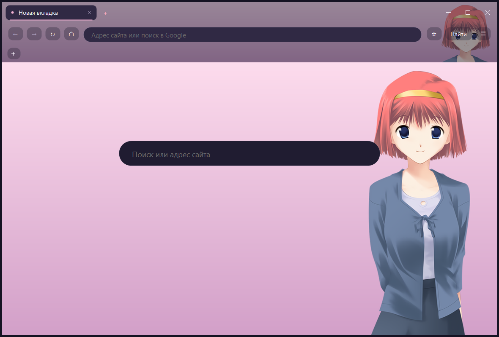
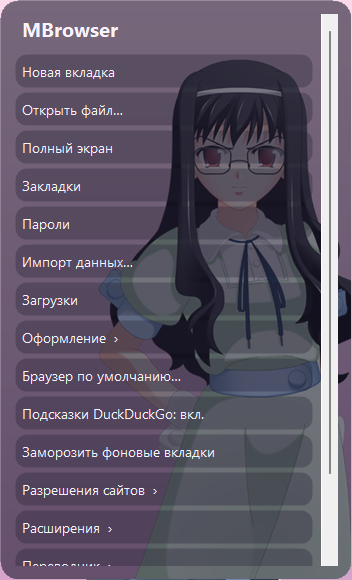
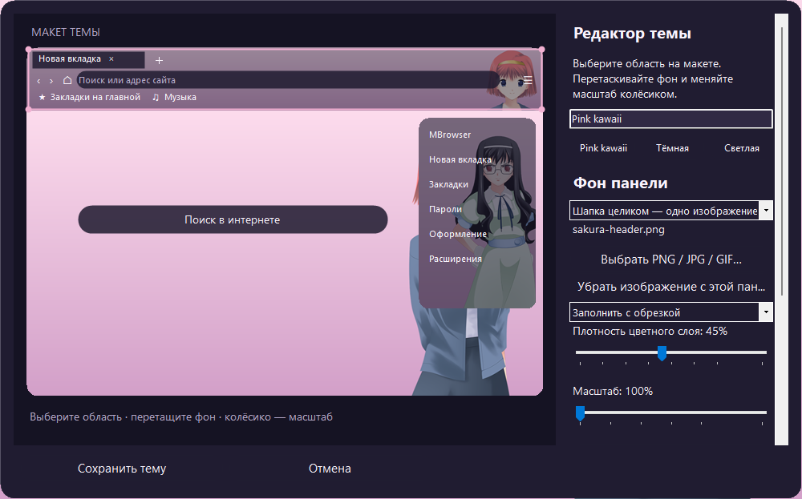
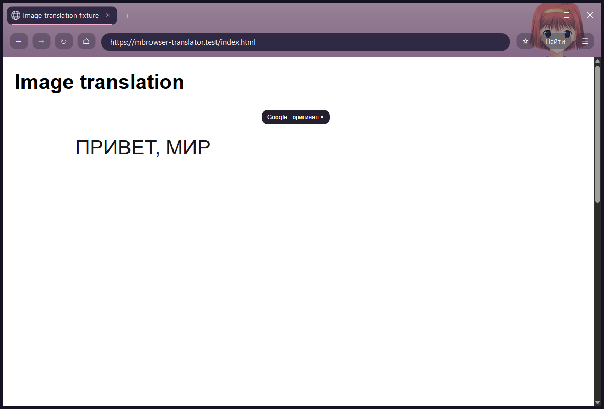

# MBrowser 4

Браузер для Windows x64 на .NET 10 / Windows Forms и системном WebView2. Без Electron.

В 4.2: круглые поля поиска и адреса, плавное появление меню и подсветка кнопок,
регистрация браузером по умолчанию и подключение официального Immersive Translate.
Сохранены единый PNG-фон шапки, закладки только на главной и графический редактор тем.







## Установка и запуск

Скачайте `MBrowser-4.2.0-Setup-x64.exe` из [Releases](https://github.com/MIGLEcorp/untitled14/releases). Установка выполняется для текущего пользователя, регистрирует MBrowser среди доступных браузеров, но сохраняет текущий выбор Windows. .NET включён; при отсутствии WebView2 установщик запускает официальный загрузчик Microsoft, которому нужен интернет. Профиль и пароли не удаляются при обновлении или удалении программы.

Для переносного запуска соберите проект и откройте `dist\MBrowser.exe` или `start.vbs`. Консоль не создаётся. Переносить нужно всю папку `dist`.

## Интерфейс

- На главной — только строка поиска и обои. Панель закладок под адресной строкой видна **только на главной / новой вкладке**. На сайтах она скрывается вместе с занимаемым местом и возвращается при переходе домой. Кнопка `＋` открывает управление закладками.
- Меню открывается **внутри клиентской области окна**, в том числе в fullscreen. Округлые элементы, фон из иллюстрации и полупрозрачная подложка. `F10` — меню, `Escape` — закрыть текущую панель, `F11` — полный экран. В fullscreen адресная строка остаётся доступной.
- Розовая тема использует рисованные спрайты **Piroshki** и **Mugenjohncel** из Ren’Py, MIT. Вся шапка — вкладки, кнопки окна, адресная панель и закладки — показывает один PNG в общих координатах, без повторения портретов на каждой полосе. Главная и меню имеют свои фоны. Источники и лицензии — [assets/ATTRIBUTION.md](assets/ATTRIBUTION.md).
- Иконки сайтов загружаются из движка для вкладок и с самого сайта для закладок, сохраняются в локальном кеше. Сторонний сервис иконок не используется.
- При вводе появляются предложения из закладок, истории открытых вкладок и DuckDuckGo. Запросы словесных подсказок отправляются после короткой паузы; строки, похожие на URL, локальный адрес или логин, в сетевой сервис не отправляются. Сетевые подсказки можно выключить прямо в меню. Локальные подсказки продолжат работать.
- Нижняя строка с расходом памяти убрана.
- Адрес и поиск рисуются как капсулы без прямоугольной подложки. Меню плавно появляется, кнопки и рамка фокуса меняют цвет за 120–170 мс. Анимации учитывают системное отключение анимации меню; общий таймер останавливается после перехода.

## Браузер по умолчанию

**Меню → Браузер по умолчанию…** открывает карточку MBrowser в настройках Windows.
Выберите «Задать по умолчанию»; отдельные типы файлов можно назначить в этой же карточке.
Поддерживаются HTTP/HTTPS, HTML/MHTML, PDF, изображения, XML, JSON и текст.
Переносная сборка регистрируется при нажатии этой кнопки; установщик делает регистрацию сам.
Выбор защищённых ассоциаций выполняется через системный интерфейс Windows.

Ссылки и файлы, открытые из других программ, передаются в существующее окно по каналу
текущего пользователя. Есть **Открыть файл… / Ctrl+O**. Локальные документы разрешаются
только после явного открытия через оболочку или диалог; сетевая UNC-папка не открывается.
При удалении программы убирается её регистрация, если она всё ещё указывает на удаляемый EXE.

## Редактор темы

Откройте **Меню → Оформление**. Слева находится интерактивный макет браузера,
справа — свойства выбранной области. Нажмите на шапку, главную или меню на макете;
перетаскивайте изображение мышью, меняйте масштаб колёсиком или ползунком.
Доступны стрелки клавиатуры для перемещения и `+`/`−` для масштаба.
PNG/JPEG/GIF можно открыть кнопкой или перетащить прямо на выбранную область.

Для каждой из трёх областей выбираются плотность подложки, масштаб 100–400%,
положение и размещение: заполнить с обрезкой, вписать или повторять плиткой.
Есть шесть цветовых образцов с палитрой, светлая/тёмная/розовая основа и имя темы.
Кнопка «Экспорт PNG фона шапки» сохраняет единый фон в размере текущей шапки.
Настоящий интерфейс тоже обновляется сразу. «Сохранить тему» применяет настройки;
отмена, Escape или закрытие редактора возвращают исходную тему. Изображение при
перемещении не перечитывается с диска. Старые темы 4.0 переводятся на единую шапку
по прежнему фону адресной панели; пользовательские файлы сохраняются.

Кнопки импорта/экспорта переносят тему вместе с изображениями в `.mbtheme`.
Файлы копируются в профиль и не зависят от исходной папки. В теме нет исполняемых
скриптов или сетевых URL. Ограничения: до 16 МБ на изображение, до 32 Мп на кадр;
GIF — до 500 кадров и 80 млн пикселей суммарно. Анимация ограничена 10 кадрами/с
и останавливается, когда окно неактивно. Исходный GIF сохраняется без перекодирования.

При ресайзе нативная рамка требует полной перерисовки клиентской области, а фон
и поиск инвалидируют старые позиции: старые кадры не копируются поверх новых.

## Заморозка без закрытия вкладок

После **5 минут нахождения приложения в фоне**, если за это время нет сетевой активности и ничего не воспроизводится или скачивается, MBrowser скрывает страницы и вызывает `TrySuspendAsync`. Вручную заморозить фоновые вкладки можно через меню. Активность отслеживается по реальным событиям загрузки сети, звуку и скачиваниям.

Вкладки **не уничтожаются**: сохраняются DOM, JavaScript-объекты, ввод в формах и собственное состояние сайта. При возвращении активная страница возобновляется в том же WebView, без перезагрузки. Старый предел в восемь страниц больше не используется для закрытия вкладок.

При успешной заморозке всех страниц браузер также запрашивает освобождение рабочих наборов renderer-процессов. Память остаётся выделенной и доступной для подкачки. **Windows сама выбирает сжатие памяти и файл подкачки**; приложение не может гарантировать запись каждой страницы памяти на диск. Это не сериализация произвольного JavaScript в файл и не восстановление DOM после завершения процесса. После закрытия программы сессия восстанавливает адреса и историю, а сайты загружаются заново. Настройки системного файла подкачки MBrowser не меняет.

Документация: [TrySuspendAsync](https://learn.microsoft.com/dotnet/api/microsoft.web.webview2.core.corewebview2.trysuspendasync), [MemoryUsageTargetLevel](https://github.com/MicrosoftEdge/WebView2Feedback/blob/main/specs/MemoryUsageTargetLevel.md).

## Разрешения и расширения

Камера, микрофон, местоположение, уведомления, буфер обмена и другие запросы сайта показываются отдельной панелью внутри окна **только в момент запроса**. После решения или закрытия панель уничтожается; постоянного окна или опрашивающего таймера нет. Можно запомнить решение для сайта и сбросить его через меню «Разрешения сайтов». В скрытых вкладках доступ автоматически не выдаётся.

Для расширений включён **Chromium WebExtensions, Manifest V3**. Меню → Расширения → Установить из папки. Перед установкой показываются запрошенные API и сайты, пакет копируется в профиль. Есть отключение и удаление. [Документация API и рабочий пример](extensions/README.md).

Проверены настоящие `content_scripts`, `chrome.storage.local`, меню изображений и блокировка запросов через `declarativeNetRequest`. Поддержка остальных API зависит от WebView2. Chrome Store/CRX и универсальная панель action-popup не реализованы. Для Immersive Translate предусмотрены отдельные встроенные панели. У расширений нет доступа к хранилищу паролей MBrowser или произвольному выполнению кода в Windows через специальный API приложения.

## Переводчик

**Меню → Переводчик → Загрузить Immersive Translate** скачивает неизменённое официальное
расширение **1.34.4** из [релиза разработчика](https://github.com/immersive-translate/immersive-translate/releases/tag/v1.34.4).
Перед распаковкой проверяется SHA-256; пакет хранится в профиле, не входит в установщик
и не загружается при каждом запуске. Подключить его можно и до открытия первого сайта.
Настройки и панель перевода открываются внутри окна. На сайте доступна плавающая кнопка
расширения и перевод через контекстное меню.

Для картинки используйте **ПКМ → Перевести текст картинки · MBrowser**. Встроенная
функция распознаёт **видимую часть** изображения через Windows OCR и накладывает
перевод поверх текста. «×» возвращает оригинал. Слой следует за картинкой при
прокрутке и изменении размеров; переведённый текст можно выделять. Исходное изображение
сайта не меняется. Эта функция работает отдельно от OCR расширения: при проверке его
собственный бесплатный OCR зависал на обработке, поэтому для встроенного пункта он не используется.

**Меню → Переводчик → Перевод картинок · язык и настройки**: выбор установленного
языка OCR (по умолчанию английский) и целевого языка перевода (по умолчанию русский). Для японского текста
нужен соответствующий язык OCR в Windows. Отдельная подписка для встроенного OCR не требуется.
Windows OCR запускается в отдельном процессе только по запросу и завершается после
операции. Снимок области и результат временные и удаляются после использования.
Изображение распознаётся локально; **только распознанный текст отправляется Google Translate**.
Используется веб-интерфейс Google без API-ключа через системный `curl.exe`; сервис может
ограничить запросы или изменить интерфейс. При ошибке показывается сообщение внутри окна.
Нужны Windows 10 2004+ / Windows 11 и установленный язык OCR.



Расширение получает доступ к содержимому страниц и сетевым запросам согласно его manifest.
Текст отправляется выбранному в его настройках сервису перевода; облачное OCR передаёт
изображение провайдеру. Можно выключить или удалить расширение в меню «Расширения».
Тариф, учётная запись и доступность внешнего сервиса управляются самим провайдером.

## Пароли и перенос данных

- Закладки: HTML, Chromium `Bookmarks`/JSON и Firefox `places.sqlite`; экспорт HTML. Папки при импорте преобразуются в общий список, повторяющиеся URL пропускаются.
- Пароли: встроенные запросы сохранения WebView2; отдельное хранилище импортированных CSV и ручных записей под Windows DPAPI. Одна подходящая запись заполняется автоматически; несколько предлагаются у поля входа. Отдельного диалога для выбора учётной записи нет. Проверяется точный origin; формы регистрации, скрытые поля, междоменные формы и iframe исключаются.
- Cookies: Firefox `cookies.sqlite`, JSON и Netscape TXT. Поддерживаются старые сроки в секундах и современные схемы Firefox 16+ в миллисекундах. Разделённые cookie переносятся с ключом сайта верхнего уровня через CDP; при отказе движка они не превращаются в обычные cookie. Контейнеры/приватные контексты остаются изолированными. Результат показывает фактически принятые и пропущенные записи.
- Защищённые базы cookies Chromium не расшифровываются: нужен выбранный пользователем экспорт JSON/TXT. Исходные базы открываются только для чтения. CSV с паролями автоматически не удаляется.

## Клавиши

| Клавиши | Действие |
| --- | --- |
| Ctrl+L / Alt+D | Адрес |
| Ctrl+T / Ctrl+W | Открыть / закрыть вкладку |
| Ctrl+O | Открыть локальный документ |
| Ctrl+Tab / Ctrl+Shift+Tab | Переключение вкладок |
| Alt+← / Alt+→ | История |
| Ctrl+D / Ctrl+Shift+B | Закладки |
| Ctrl+Shift+P | Управление паролями |
| Ctrl+J | Загрузки |
| F5 / Ctrl+R | Обновить / остановить |
| F10 | Внутреннее меню |
| F11 / Escape | Полный экран / закрыть панель или выйти |

## Профиль

`%LOCALAPPDATA%\FeatherBrowser\`: `session.json`, `preferences.json`, `theme.json`, `bookmarks.json`, `passwords.dpapi`, `Favicons\`, `Extensions\`, `WebView2\`. WebKit использует отдельные `WebKitPreview\` и `Engines\WebKit\`. Профиль содержит адреса и данные сайтов; это не приватный режим. DPAPI-хранилище привязано к учётной записи Windows.

Путь `FeatherBrowser` сохранён для совместимости: обновление до MBrowser использует
прежние пароли, куки, закладки и сессию. Старые строковые настройки темы читаются.
Изображения новых тем хранятся в `ThemeMedia\`. Установщик обновляет прежнюю установку
с тем же идентификатором, заменяет старые исполняемые файлы и ярлыки. Новый процесс,
описание файла и значок называются MBrowser; заголовок окна начинается с MBrowser.
Дочерние процессы движка WebView2 сохраняют системное имя Microsoft. На части новых
Windows 11 они также могут попадать в отдельную группу «Диспетчер WebView2»:
[открытая ошибка Microsoft #5628](https://github.com/MicrosoftEdge/WebView2Feedback/issues/5628).
Переименование основного EXE и AppUserModelID не устраняет эту ошибку. Бинарные
файлы системного Runtime не переименовываются и не модифицируются.

## WebKit

Настоящий WebKit доступен отдельным экспериментальным окном Playwright; основные вкладки остаются WebView2. Runtime скачивается только по запросу. Профили движков не синхронизируются. Это тестовый runtime, не Safari и не полноценный второй движок встроенных вкладок. Подробности — [ENGINE.md](ENGINE.md).

## Сборка, установщик и тесты

Нужен .NET SDK 10. Для установщика — Inno Setup 6+ (`ISCC.exe` в PATH или `bin\tools\InnoSetup`). Официальный загрузчик WebView2 проверяется по цифровой подписи.

```powershell
dotnet build .\MBrowser.csproj -c Release
powershell -NoProfile -ExecutionPolicy Bypass -File .\test.ps1
powershell -NoProfile -ExecutionPolicy Bypass -File .\build.ps1 -Installer
powershell -NoProfile -ExecutionPolicy Bypass -File .\test.ps1 -Published
```

`dist` — самостоятельная сборка с .NET, `artifacts` — установщик. WebView2 Runtime остаётся системным. Тесты используют временный профиль и loopback/виртуальные тестовые сайты: проверяют сохранение состояния при заморозке, меню/fullscreen, разрешения, настоящий API расширений, пароли, импорт, шифрование и выгрузку необязательного модуля. Обычный профиль не используется. Отчёты: `core-results.txt`, `smoke-results.json`; снимок главной — `preview.png`.

Онлайн-проверка переводчика включается отдельно: задайте `MBROWSER_TRANSLATOR_TEST_ARCHIVE`
путь к официальному ZIP версии 1.34.4 и запустите `test.ps1`. Она проверяет реальную
установку расширения, его настройки и перевод тестовой картинки `HELLO WORLD` на русский,
включая возврат оригинала. Только в этой проверке тестовый текст отправляется Google.
Обычные проверки не обращаются к сервису перевода.

## Код

| Файлы | Назначение |
| --- | --- |
| `MainForm.Chrome.cs`, `Menu.cs` | Панели, меню внутри окна |
| `MainForm.Bookmarks.cs`, `Suggestions.cs`, `FaviconCache.cs` | Закладки, предикт, иконки |
| `MainForm.Tabs.cs`, `WebViews.cs`, `Sleep.cs` | Вкладки, события движка, приостановка и возобновление |
| `MainForm.Permissions.cs`, `Extensions.cs` | Запросы доступа, Manifest V3 |
| `MainForm.Translator.cs`, `TranslatorPackage.cs` | Подключение официального переводчика и его панели |
| `MainForm.ImageTranslation.cs`, `ImageText.cs`, `Engine\ImageOcr\` | Слой перевода, временный процесс Windows OCR и сетевой перевод текста |
| `BrowserRegistration.cs`, `BrowserActivation.cs`, `MainForm.Activation.cs` | Ассоциации Windows, файлы и передача ссылок открытому окну |
| `MainForm.Passwords.cs`, `AutofillPageScripts.cs` | Автозаполнение и подсказки учётных записей |
| `BrowserChrome.cs`, `UI\` | Нативная главная, вкладки, округлые элементы, рамка |
| `UI\ThemeEditor.cs`, `ThemeSettings.cs`, `ThemeMedia.cs`, `ThemePackage.cs` | Предпросмотр и сохранение тем, фоны/GIF, переносимые пакеты |
| `Features\`, `FeatureModule.cs` | Выгружаемый модуль библиотеки, импорт, SQLite, DPAPI |
| `extensions\` | Описание публичного API и пример расширения |
| `installer\MBrowser.iss` | Исходник установщика |

Сравнительных бенчмарков с Firefox нет. Оригинальные рисунки не используются для обучения или генеративных преобразований.
